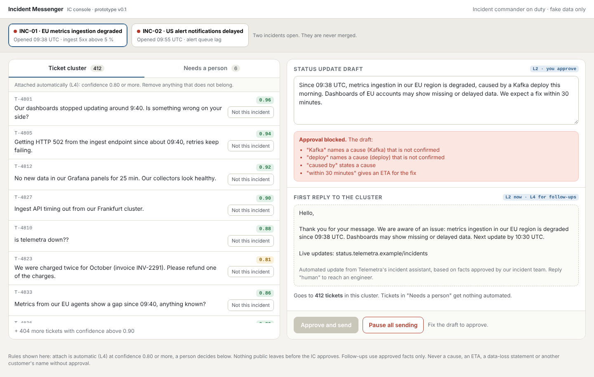

# 03 — Prototype link · Incident Messenger (P3)

> One clickable prototype of where the agent lives (the IC console), made in under an hour. Fake data only.

- **Link:** https://claude.ai/artifact/JbzdJPP25WsiBy7m7f2hMe (share it with the team and testers from the page's Share menu) · source in `prototype/ic_console.html` (opens in any browser)
- **Tool:** Claude artifact
- **Version:** v0.1 — incident rail, ticket cluster with confidence, "needs a person" queue, guarded status-update draft, first reply, Approve and Pause. v0.2 (planned from the simulated tests): blocked words highlighted in the draft, component-mismatch flag on tickets, region on every ticket, phone-first approve.
- **The prompt we used (the brief in three paragraphs):**

```
Paragraph 1 — who uses it and for what job:
The incident commander at Telemetra, a DevOps / observability SaaS, during a platform incident. Job: in under
5 minutes, check which tickets belong to the incident, approve one public status update and the first reply
to the cluster, so customers get one fast, consistent answer instead of waiting 40 minutes.

Paragraph 2 — what is on the screen (and the one thing it must never do):
Open incidents on top (two can overlap: EU ingestion and US alert delays, never merged). Left: the ticket
cluster with an attach-confidence score per ticket, a "Not this incident" button, and a separate "needs a
person" tab (ETA, data loss, low confidence, non-English). Right: the drafted status update, a guardrail box,
the recipient count, the templated first reply with the AI disclosure, Approve and Pause all sending.
It must never publish a cause, ETA, impact or data-loss statement the IC has not approved, or name a customer.

Paragraph 3 — the rules:
Attach L4 above 0.80 confidence, L1 below. Status update and first reply are L2: nothing is sent until the IC
approves; the guardrail blocks approval while the draft states a cause or an ETA. Follow-ups are L4 on approved
facts. Pause falls back to the auto-acknowledge reply with the status-page link.
```

- **Usability task (for `03_user_research.md`):** fix the draft so it can be approved, find the ticket that should not be in the cluster, approve. (Planted traps: the draft states an unconfirmed Kafka cause and a 30-minute ETA; ticket T-4823 is a billing question attached at 0.81.)
- **Screenshot:** 
- **Source file:** `prototype/ic_console.html` was rebuilt on 8 November 2026 from the prompt above (same screen, same planted traps, same scenario as `evals/eval_set_v0.csv`), because the original artifact source had not been committed. Open it in any browser, no install needed.
