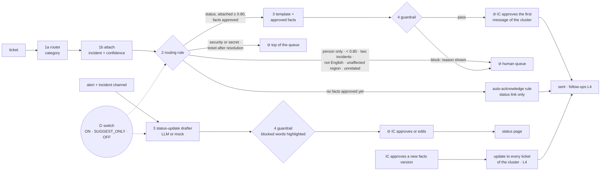

# 04 · Architecture — Team 9 · Incident Messenger (P3)

> Session 4 deliverable. It describes the prototype we built in `/prototype` (v1, November 2026), not the one we plan. Every line matches a file there.

## 1. One-line description
During a Telemetra platform incident, a workflow attaches each incoming ticket to the right open incident, answers the plain "is it down?" tickets with a template filled with the facts the incident commander (IC) approved, drafts the status update for the IC, and sends everything else to a person.

## 2. The diagram



Plain-text version (same flow):
```
ticket ─▶ [1a router] ─▶ [1b attach] ─▶ [2 rule] ─┬─▶ [3 template + approved facts] ─▶ [4 guardrail] ─▶ ⊘ IC approves 1st message ─▶ sent
                                                 ├─▶ no facts yet ─▶ auto-acknowledge rule (status link) ─▶ sent
                                                 ├─▶ ⊘ human queue (person only · < 0.80 · two incidents · not EN · unaffected region · unrelated)
                                                 └─▶ ⊘ top of the queue (security / secret · after resolution)
alert + channel ─▶ [3 status-update drafter] ─▶ [4 guardrail] ─▶ ⊘ IC approves or edits ─▶ status page
⏻ switch: ON · SUGGEST_ONLY (drafts shown, nothing sendable) · OFF (humans only, auto-acknowledge rule) — Head of Support; IC or support lead on duty
```

## 3. Component table
| # | Component | Rung | Pattern | Trust level | Checkpoint ⊘ | Metric observed |
|---|---|---|---|---|---|---|
| 1a | Router: ticket → status · impact · cause_credit · unrelated (`router.py`) | 2 · classical ML (TF-IDF on words and characters + logistic regression, 240 synthetic training tickets) | routing | L4 — internal tag, nothing is sent | none | category accuracy |
| 1b | Attach: ticket → open incident + confidence (`attach.py`) | 1 · rules on time window, account region, component words. The brief planned rung 3 (embeddings): we start one rung lower and climb only if the eval-set says the rules fail | routing | L4 at ≥ 0.80 · L1 below | abstention: < 0.80, two incidents within 0.10, unaffected region → human queue | attach precision (floor 0.90) and recall |
| 2 | Routing rule (`route_rule.py`) | 1 · rules | routing — the gate between the steps | sets the level per ticket | abstention: person-only topics, not English, unrelated; security and reopens to the top | action accuracy · sent on human-only = 0 |
| 3a | Customer reply (`draft.py`) | 1 · template + the IC-approved facts, word for word | prompt chaining (fill a template) | L2 first message of each cluster · L4 follow-ups | approval: the IC approves the first message of each cluster | sendable as is (two graders) |
| 3b | Status-update draft (`draft.py`) | 3 · pretrained LLM restricted to the alert line and the IC's lines (mock drafter in v1, same contract, no API key) | prompt chaining | L2 | approval: the IC approves or edits before anything is published | share of drafts the IC publishes with minor edits (H2) |
| 4 | Guardrail checker (`policy.py`) | 1 · rules: allowlist of approved sentences, cause / ETA / data-loss / internal-number patterns, customer names, secrets | evaluator without an optimizer loop: it blocks, it never rewrites | — | block → reason shown, not sendable; blocked words highlighted for the IC | guardrail violations sent = 0 · policy blocks |
| ⏻ | Override switch (`switch.py`, sidebar of `app.py`) | 1 · a feature flag | — | drops the whole system to L1 (SUGGEST_ONLY) or off | ⏻ | last tested (§6) |

Around them: `pipeline.py` runs the steps in order; `evals.py` scores them on the eval-set; `grading.py` builds the graders' sheets; `app.py` is the IC console (Streamlit — the demo surface; a FastAPI service would be the production surface).

## 4. Workflow or agent?
**A workflow.** We can draw the path in advance — classify, attach, decide, fill the template, check, approve — and we did, above. The model never chooses its next step or a tool: the only language-model call drafts a status update that goes to the IC, never to a customer. That is the right choice for our risk: every public word is written and timestamped, so the checkpoints have to be set by the design, not by a model's confidence (the Chevrolet and Air Canada lesson). It also keeps the cost per ticket fixed and every failure explainable ("step 1b returned two incidents"). **To move one step up** — an agent that looks up the account → component map and messages accounts before they write (our cut "proactive messages") — three things would have to be true: attach precision ≥ 0.90 on 200 replayed tickets (H1), the IC publishing ≥ 80 % of drafts with minor edits (H2), and an account → component map we can trust.

## 5. Fallbacks
- **Retrieval finds nothing:** no open incident matches, or the account's region is not affected → no reply; the ticket goes to the human queue with the note. An incident is open but the IC has not approved facts yet → only the auto-acknowledge rule (status link, "we are investigating").
- **Confidence below the threshold:** attach < 0.80, or two incidents within 0.10 → human queue with the candidates and their scores; two incidents are never merged.
- **The policy checker blocks:** the text is not sent; the reason is shown; the ticket goes to the human queue. For the IC's draft, the blocked words are highlighted and Approve stays disabled until they are edited.
- **The API is down:** the status-update drafter falls back to the mock drafter (same contract); customer replies use no API. If the service itself is down, the switch goes to OFF and the auto-acknowledge rule answers (outage class, `06_07_experiments_operations.md` §4). If the IC has not approved within 10 minutes: a reminder, never a publication on time-out.

## 6. The override switch ⏻
- **Who can switch it:** the Head of Support (owner); by day the IC or the support lead on duty, at night the on-call support lead — one click in the IC console sidebar.
- **Scope:** everyone (all clusters at once): ON · SUGGEST_ONLY (drafts shown, nothing sendable — L1) · OFF (humans only, auto-acknowledge rule). Per ticket: the "Not this incident" button moves one ticket to the human queue.
- **Tested on:** 17 November 2026 (16:47 UTC, by Till Lüder, all three positions passed) with `python prototype/rollback_drill.py` — logged in `evals/rollback_tests.csv`.

## 7. Data
- **Demo and training data** (`prototype/data/`, all synthetic): `tickets_synthetic.csv` — 240 tickets that train the router, generated by `make_tickets.py`; `incidents.json` — four invented incidents and the facts the IC approved, version by version (our knowledge base); `accounts.csv` — ten invented accounts; `demo_inputs.csv` — the ten inputs of the console.
- **Evaluation data** (`evals/`): `eval_set_v0.csv`, 50 cases (Assignment 4), and `eval_set_v1.csv`, 100 cases (Assignment 5). Inputs synthetic, drafted with Claude without labels; **labels written by hand by Till Lüder before the prototype ran on them; never used for tuning.** The first 20 cases were read while writing `spec.md`: they are reported separately in `evals/report_v0.md` §4.
- **Personal data:** none in the prototype. In production, ticket text holds names and e-mails of our customers' employees, and sometimes pasted secrets: secrets are redacted before any model call (`policy.redact`); storage, access and retention are in `governance.md` (Sessions 3 and 4).

## 8. Eval result v0
*15 of the 16 status tickets that should get an automatic reply got one that two graders would send unchanged (94 %; 84 % re-weighted to real traffic) — criterion 63 %. But two replies went where a person had to answer (P3-08, P3-34) and none of the 3 drafts for the IC was publishable unchanged: not releasable.* (`evals/report_v0.md`)

## 9. What we would build next
1. The IC's draft: a "what customers may see" sentence and an explicit since-time — the LLM drafter (rung 3) instead of the mock (`spec.md` M1).
2. Two rules in step 2 and 1b: scope-of-impact questions to a person (M2); only symptom words count for attach (M3) — with the held-out lines of `spec.md`, the floors back to zero on `eval_set_v1`.
3. A reminder at the next-update time, and the FastAPI service behind the incident tool for a shadow-mode pilot (M4, `06_07` §3).
